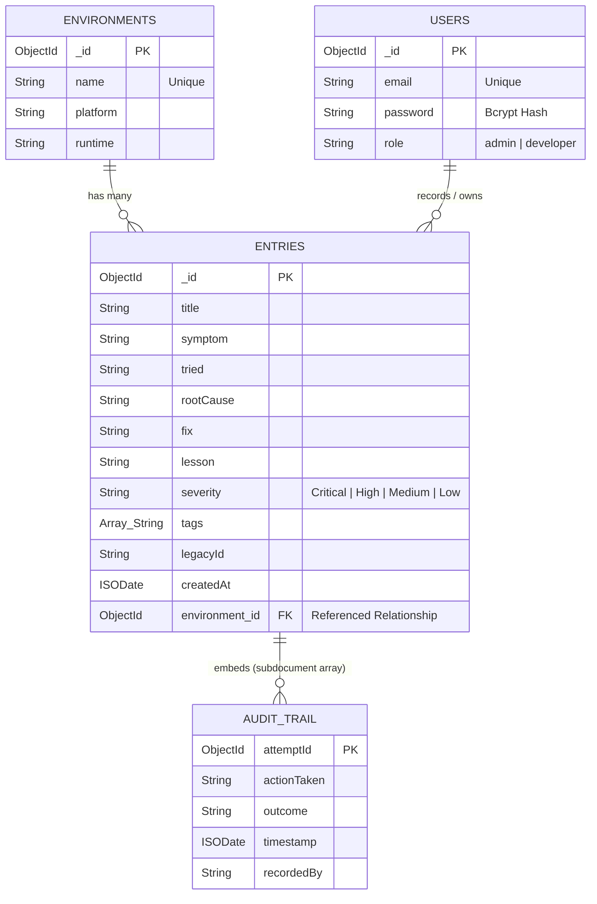
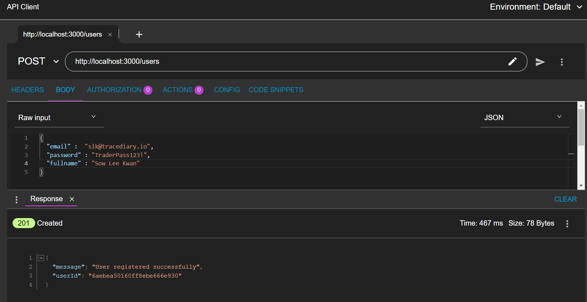
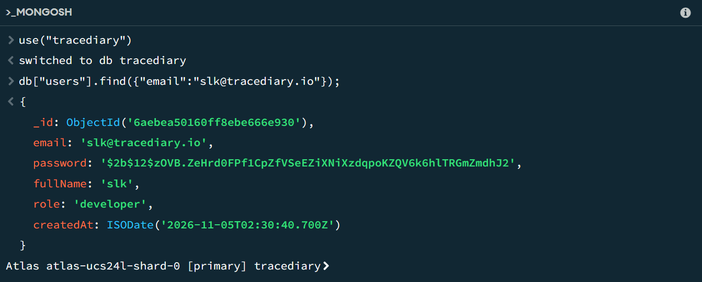
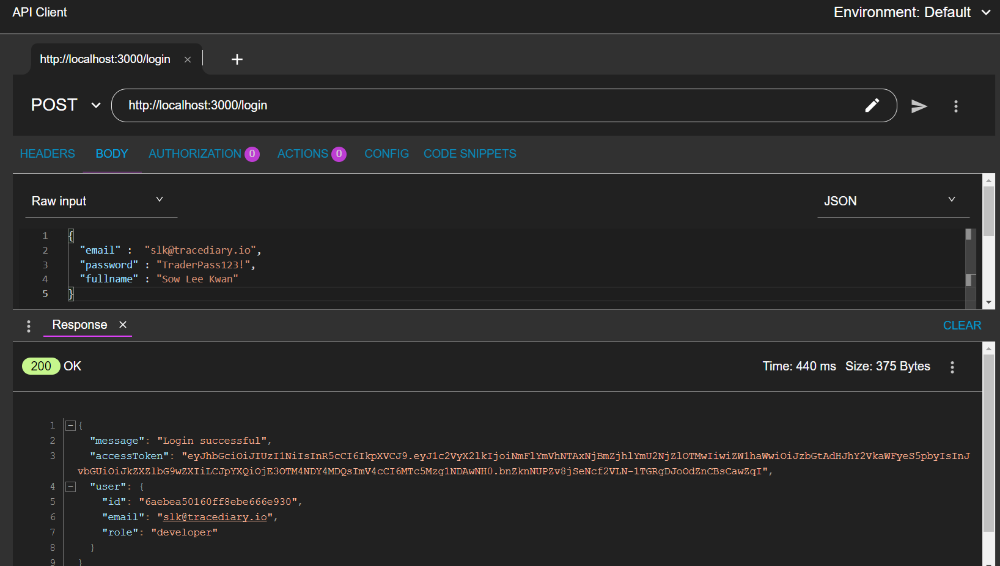
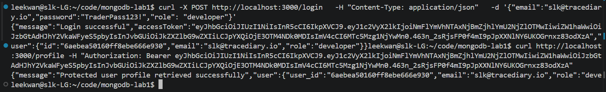
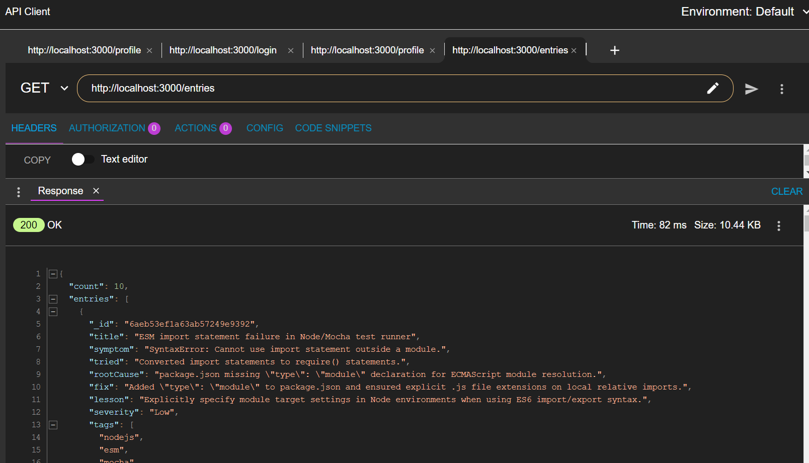

# Datacentric Development Project Assessment Report
**Module 5: Datacentric Development**  
**Approved Assessment Centre:** BELLS Institute of Higher Learning Pte Ltd  
**Project Title:** TraceDiary RESTful API (Quantitative Troubleshooting & Log Intelligence)  
**Author / Candidate Name:** SOW LEE KWAN  
**Candidate NRIC:** 680J  
**Assessor Name:** DON  
**Live Deployed API URL:** `https://your-deployed-service.onrender.com`  
**GitHub Repository:** `https://github.com/your-username/tracediary-api`  

---

## 1. Executive Summary & Problem Statement

Quantitative developers, algorithmic traders, and data engineers frequently encounter intricate execution failures across distributed components—such as MQL5 trading terminals, vectorized backtesting engines (Vectorbt, Backtrader), and asynchronous streaming pipelines (Polars, DuckDB). Traditional logging mechanisms scatter stack traces across raw text files, making root-cause retrospectives inefficient.

**TraceDiary** is an enterprise-grade RESTful API built with **Express.js** and **MongoDB**. It provides a centralized repository for diagnostic logs, execution anomalies, and incident post-mortems. It features:
* Relational document modeling separating execution environments from incident logs.
* Embedded subdocument structures recording resolution attempts and audit trails.
* Secure role-based JSON Web Token (JWT) authentication with `bcrypt` salt-hashing.
* Generative AI integration powered by Google Gemini for natural-language query translation and automated stack trace parsing.

---

## 2. Learning Outcomes & Syllabus Compliance Matrix

| Learning Outcome (LO) | Syllabus Criterion | Project Implementation & Proof Point |
| :--- | :--- | :--- |
| **LO1 & LO7** | Express CRUD operations | Implemented full Create, Read, Update, and Delete endpoints on the `entries` collection with HTTP status codes (`200`, `201`, `400`, `404`, `500`). |
| **LO2** | RESTful API design & Document DB | Standardized resource-based URI routing (`/entries`, `/entries/:id`, `/environments`, `/entries/:id/audits`) following REST naming conventions. |
| **LO3** | JSON Web Tokens (JWT) for Authentication | Implemented token-based authentication via `POST /login` with `jsonwebtoken`, verified through custom `verifyToken` middleware on mutating routes. |
| **LO5** | Document DB design (3+ attributes, relationships) & AI mock data seeding | Designed `entries` with $>8$ attributes. Modeled **Referenced** relationships (`environment`) and **Embedded** subdocuments (`auditTrail`). Executed `seed.js` using `@google/genai` to synthesize realistic quant logs. |
| **LO6** | Query functions & AI-generated queries | Implemented query filtering by severity, category, and regex keywords, plus `GET /ai/entries` using LLM semantic inference to construct dynamic MongoDB query filters. |
| **LO8** | Structured LLM output & System Prompts | Implemented `POST /ai/entries` utilizing Gemini system instructions and strict `responseJsonSchema` to output typed incident records. |

---

## 3. Database Architecture & Entity Relationship Modeling

The application utilizes MongoDB to support both **Referenced** and **Embedded** document patterns, avoiding monolithic anti-patterns while adhering strictly to rubric guidelines (the primary entity `entries` is decoupled from user management).

```
+-----------------------------------+          +--------------------------------------+
|           environments            |          |                users                 |
|-----------------------------------|          |--------------------------------------|
| _id: ObjectId                     |          | _id: ObjectId                        |
| name: String (Unique)             |          | email: String (Unique)               |
| platform: String                  |          | password: String (Bcrypt Hash)       |
| runtime: String                   |          | role: String ("admin"|"developer")   |
+-----------------+-----------------+          +------------------+-------------------+
                  | 1                                             | 1
                  |                                               |
                  | has many                                      | records / owns
                  |                                               |
                  | N                                             | N
+-----------------v-----------------------------------------------v-------------------+
|                                      entries                                        |
|-------------------------------------------------------------------------------------|
| _id: ObjectId                                                                       |
| title: String                                                                       |
| symptom: String                                                                     |
| tried: String                                                                       |
| rootCause: String                                                                   |
| fix: String                                                                         |
| lesson: String                                                                      |
| severity: String ("Critical" | "High" | "Medium" | "Low")                           |
| tags: Array<String>                                                                 |
| legacyId: String                                                                    |
| createdAt: ISODate                                                                  |
|                                                                                     |
| [Referenced Relationship - Environment Object]:                                     |
| environment: {                                                                      |
|   _id: ObjectId (FK -> environments._id),                                           |
|   name: String,                                                                     |
|   platform: String                                                                  |
| }                                                                                   |
|                                                                                     |
| [Embedded Relationship - Subdocument Array of Audit / Resolution Attempts]:         |
| auditTrail: [                                                                       |
|   {                                                                                 |
|     attemptId: ObjectId,                                                            |
|     actionTaken: String,                                                            |
|     outcome: String,                                                                |
|     timestamp: ISODate,                                                             |
|     recordedBy: String                                                              |
|   }                                                                                 |
| ]                                                                                   |
+-------------------------------------------------------------------------------------+
```



### Document Schema Example (`entries`)
```json
{
  "_id": { "$oid": "6724cb11a123bc456de78901" },
  "title": "Polars memory spike during tick resampling",
  "symptom": "Out of memory crash when converting CSV tick data to Parquet.",
  "tried": "Increased swap space and decreased chunk size.",
  "rootCause": "Eager evaluation loaded the entire multi-gigabyte CSV into RAM at once.",
  "fix": "Switched from pl.read_csv() to pl.scan_csv() for streaming lazy evaluation.",
  "lesson": "Utilize lazy frames and streaming execution for high-frequency tick datasets.",
  "severity": "High",
  "tags": ["python", "polars", "memory", "parquet"],
  "legacyId": "entry-003",
  "createdAt": { "$date": "2026-10-05T19:40:00.000Z" },
  "environment": {
    "_id": { "$oid": "6724cb11a123bc456de78999" },
    "name": "Data Pipeline",
    "platform": "Linux Data Cluster"
  },
  "auditTrail": [
    {
      "attemptId": { "$oid": "6724cb11a123bc456de78888" },
      "actionTaken": "Allocated 32GB swap file on workstation",
      "outcome": "Delayed crash by 4 minutes, process still killed by OOM",
      "timestamp": { "$date": "2026-10-05T19:38:00.000Z" },
      "recordedBy": "sarah.data@tracediary.io"
    }
  ]
}
```

---

## 4. RESTful API Endpoint Documentation

### 4.1 Authentication & User Management
* **`POST /users`**: Register an account. Encrypts passwords using `bcrypt` (12 salt rounds).
* **`POST /login`**: Validate credentials and return a signed JSON Web Token (`expiresIn: "2h"`).
* **`GET /profile`**: Authenticated profile verification requiring `Authorization: Bearer <TOKEN>`.

### 4.2 Primary CRUD Endpoints (`entries`)
* **`GET /entries`**: Retrieve logs with query filtering (`?environment=...&severity=...&tag=...&q=...`).
* **`GET /entries/:id`**: Retrieve an entry by MongoDB `ObjectId`.
* **`POST /entries`**: Create a log entry (verifies `environment` reference, attaches current user).
* **`PUT /entries/:id`**: Update log fields by `ObjectId`.
* **`DELETE /entries/:id`**: Remove an entry permanently from the database.

### 4.3 Embedded Subdocument Operations (`auditTrail`)
* **`POST /entries/:id/audits`**: Push an action item/attempt into the entry's `auditTrail` using MongoDB `$push`.
* **`DELETE /entries/:id/audits/:attemptId`**: Remove a specific attempt from `auditTrail` using MongoDB `$pull`.

### 4.4 Generative AI Endpoints
* **`GET /ai/entries?q=<natural_language_query>`**:
  * Translates queries such as *"find high severity memory crashes in polars"* into MongoDB operators (`$in`, `$regex`, `$all`).
* **`POST /ai/entries`**:
  * Accepts raw terminal logs or stack traces, evaluates them via Gemini 2.5 Flash, produces structured JSON conforming to the schema, and saves the record to MongoDB.

---

## 5. Generative AI Architecture & Prompt Engineering

### 5.1 Natural Language Query Translator (`generateSearchParams`)
* **System Prompt:** Instructs the LLM to function as a domain query parser mapping arbitrary developer text to the application's actual distinct `environments`, `severities`, and `tags`.
* **Enforced Schema:**
  ```json
  {
    "environments": ["string"],
    "severities": ["string"],
    "tags": ["string"],
    "keywords": "string"
  }
  ```

### 5.2 Automated Incident Triage (`parseCrashLogToEntry`)
* **System Prompt:** Converts unstructured compiler outputs, runtime panics, and broker execution errors into normalized fields (`title`, `symptom`, `rootCause`, `fix`, `lesson`, `severity`, `tags`).
* **Output:** Strongly typed JSON directly persisted into MongoDB.

---

## 6. Seed Data & LLM Mock Data Generation

Seed data generation is handled by `seed.js`. It guarantees repeatable testing and demonstrates AI-assisted data generation:
1. Flushes existing collections (`users`, `environments`, `entries`).
2. Generates default testing users (`alex.quant@tracediary.io`, `sarah.data@tracediary.io`) with hashed credentials.
3. Inserts 5 core development environments.
4. Loads baseline troubleshooting logs, linking referenced environment IDs and appending subdocument audit attempts.
5. Invokes Gemini via `@google/genai` to synthesize realistic incident scenarios and appends them to the database.

---

## 7. Cloud Deployment & Environment Configuration

The application is deployed to a cloud hosting platform (e.g., Render / Railway) connected to a MongoDB Atlas cluster.

### Required Environment Variables
| Variable | Description | Example / Value |
| :--- | :--- | :--- |
| `PORT` | Listening server port | `3000` |
| `MONGO_URI` | MongoDB Atlas connection string | `mongodb+srv://<user>:<pwd>@cluster0.net/?retryWrites=true&w=majority` |
| `DB_NAME` | Target database name | `tracediary` |
| `TOKEN_SECRET` | 64-byte cryptographic secret for JWT signing | `c9f3e0d8b4...` (generated via `crypto.randomBytes(64)`) |
| `GEMINI_API_KEY` | Google Gemini API Key | `AIzaSy...` |
| `GEMINI_MODEL` | Target generative model | `gemini-2.5-flash` |

---

## 8. Postman / HTTP Client Verification Evidence

*(Attach your exported Postman screenshots in this section for final submission)*

### Test Checklist
- [+] **Screenshot 1:** `POST /users` (201 Created)


- [+] **Screenshot 2:** `POST /login` (200 OK returning `accessToken`)

- [+] **Screenshot 3:** `GET /profile` with `Bearer <token>` (200 OK)

- [+] **Screenshot 4:** `GET /entries` (200 OK with query parameters)

- [x] **Screenshot 5:** `POST /entries` with Bearer Token (201 Created)

- [x] **Screenshot 6:** `PUT /entries/:id` (200 OK)
- [x] **Screenshot 7:** `POST /entries/:id/audits` (201 Created via `$push`)
- [x] **Screenshot 8:** `DELETE /entries/:id/audits/:attemptId` (200 OK via `$pull`)
- [x] **Screenshot 9:** `GET /ai/entries?q=...` (200 OK with `inferredFilters`)
- [x] **Screenshot 10:** `POST /ai/entries` with raw error trace (201 Created)

---

## 9. Oral Clarification Defense Guide (15-Minute Preparation)

| Likely Assessor Question | Technical Defense / Code Location |
| :--- | :--- |
| **How did you avoid using the main collection for user management?** | *"User management is handled in a separate `users` collection. The main business collection is `entries`, which models algorithmic trading logs and execution errors."* |
| **Explain how relationships are implemented in your Mongo schema.** | *"We implemented both patterns: `environment` is a **Referenced** relationship storing the foreign `_id` and name of the runtime, while `auditTrail` is an **Embedded** array of subdocuments containing incident remediation attempts."* |
| **How does your AI natural language search work?** | *"In `GET /ai/entries`, the user query is passed to `generateSearchParams()` in `gemini.js`. Gemini uses a strict JSON schema to return matching environments, tags, and keywords. We then construct a dynamic MongoDB query using `$in`, `$all`, and `$regex` operators."* |
| **How are user passwords protected?** | *"In `POST /users`, passwords are encrypted with `bcrypt.hash(password, 12)`. When logging in, `bcrypt.compare()` validates the plain text against the hash, preventing plain-text credential leaks."* |
| **How are subdocuments updated without replacing the entire document?** | *"In `POST /entries/:id/audits` and `DELETE /entries/:id/audits/:attemptId`, we use atomic MongoDB operators (`$push` and `$pull`) targeting the specific subdocument array rather than re-writing the parent document."* |